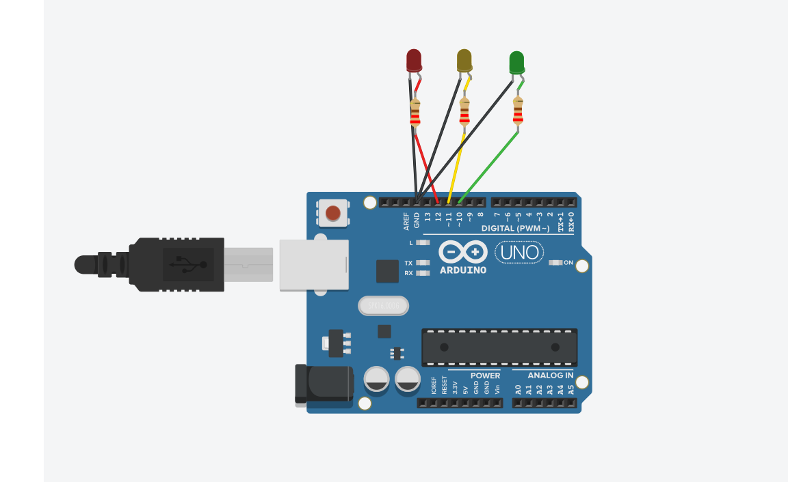

# semaforo-arduino
Projeto de simulação de um semáforo com Arduino no Tinkercad, desenvolvido como atividade do Curso da Unesp. 
## Objetivo do projeto. 

Simular o funcionamento de um semáforo utilizando Arduino no Tinkercad, por meio de três LEDs nas cores verde, amarelo e vermelho.

A atividade busca compreender o funcionamento de circuitos elétricos e a utilização da programação em situações do cotidiano.

## Link do projeto no Tinkercad
https://www.tinkercad.com/things/4S9sPCiPomH-semaforo-com-arduino-unesp

## Uso na escola 

**Ano escolar:** 8º ano do Ensino Fundamental.

**Componente curricular:** Ciências.

**Tema:** Circuitos elétricos, tecnologia e educação para o trânsito.

**Título da atividade:** Semáforo com Arduino: a tecnologia no cotidiano.

**Resolução de um problema do cotidiano:**

Como a tecnologia pode contribuir para a organização do trânsito e a segurança de motoristas e pedestres?

**Objetivo:**

Compreender o funcionamento de um circuito elétrico simples e a importância da programação no controle de dispositivos eletrônicos, utilizando a simulação de um semáforo no Tinkercad.

**Desenvolvimento da atividade:**

Vou iniciar a atividade conversando com os alunos sobre a importância dos semáforos para o trânsito, perguntando se observam esses equipamentos no caminho para a escola e qual a função de cada cor.

Em seguida, serão apresentados os componentes utilizados na montagem do circuito, como Arduino, LEDs, resistores e fios de conexão.

Por meio do Tinkercad, os estudantes observarão a simulação do semáforo, identificando a sequência de funcionamento das luzes verde, amarela e vermelha e os tempos programados para cada uma.

Durante a atividade, serão discutidas a função dos componentes, a importância da programação e a aplicação da tecnologia em situações do cotidiano.

**Recursos:**

Computador, internet e plataforma Tinkercad.

**Avaliação:**

A avaliação será realizada durante a atividade, observando a participação dos alunos, as respostas de perguntas e a compreensão do funcionamento do semáforo e dos componentes do circuito.

**Resultados:**

Espera-se que os estudantes compreendam o funcionamento básico de um circuito elétrico, reconheçam a importância da programação e relacionem o uso da tecnologia à segurança no trânsito, proporcionando momentos de interação e protagonismo juvenil.
